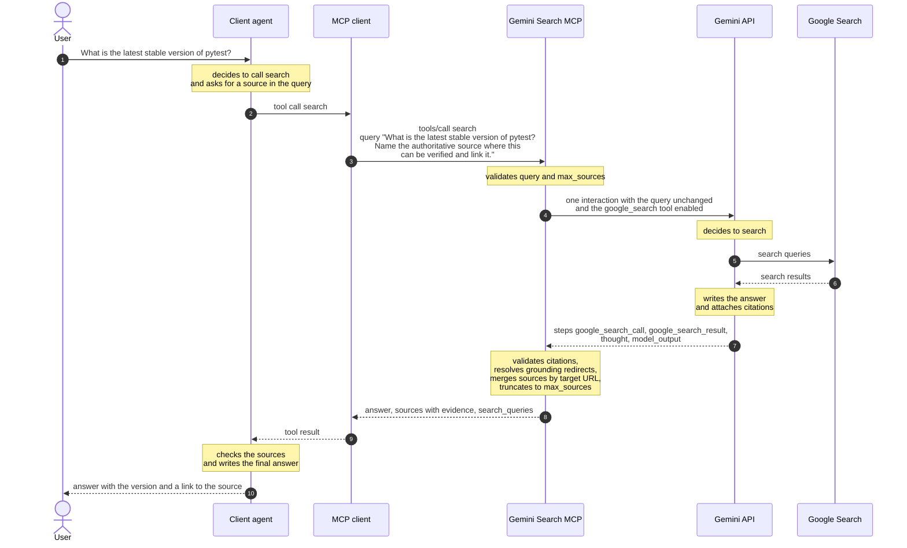

# Gemini Search MCP

Gemini Search MCP gives AI agents web search: an MCP server that answers a
question with Google Search through Gemini and returns the answer together
with its sources and the passages each source supports. It is a self-hosted
alternative to search APIs such as Tavily or Serper and to the built-in web
search of an agent, for anyone who wants to run search on their own Gemini API
key.

It offers two tools: `search`, and the optional `analyze_url` for one question
about one public URL. If Gemini did not search, the source list is empty; if a
page lacks the answer, `analyze_url` says so.

The server is built for personal use: one static bearer token, no user
management. It runs over stdio for local clients and over stateless Streamable
HTTP for remote ones. A multi-architecture container image and a local Docker
Compose setup with Caddy are in the repository; images are not published.

> [!IMPORTANT]
> **Running this server costs money, and it does not work with the Gemini free
> tier.** You need a Gemini API key of a project on the paid tier, that is with
> billing enabled.
>
> - Every token is billed; the paid tier has no free token allowance.
> - The first 5,000 Google Search queries per month are free, then 1,000
>   queries cost 14 USD. Counted is each search query Gemini runs, not each
>   `search` call; one call ran 2.3 queries on average in our runs.
> - A `search` call cost about 0.25 US cents in tokens in our runs. Once the
>   free queries are used up, the search fee adds about 3 US cents per call.
>
> Figures and examples: [Costs](#costs). Source of the prices, checked on
> 2026-11-13: [Gemini API pricing](https://ai.google.dev/gemini-api/docs/pricing).

## Contents

- Understand and use
  - [Tools](#tools): inputs, outputs and errors of `search` and `analyze_url`
  - [How a search works](#how-a-search-works)
  - [What the server gets from Gemini and what it returns](#what-the-server-gets-from-gemini-and-what-it-returns)
  - [Answer, answer with sources, fact only](#answer-answer-with-sources-fact-only): how to phrase a query
  - [When to use `analyze_url`](#when-to-use-analyze_url)
- Operate
  - [Prerequisites](#prerequisites) and [Installation](#installation)
  - [Running the server](#running-the-server): configuration, stdio, Streamable HTTP, container, timeouts, logging
  - [Security](#security)
  - [Data protection](#data-protection)
  - [Costs](#costs): prices and what a call costs
- Develop
  - [Development](#development)
  - [Documentation](#documentation)

## Tools

The server offers two tools. `search` is always registered. `analyze_url` is
off by default and is registered only with `ANALYZE_URL_ENABLED=true`
([ADR 0010](docs/adr/0010-configuration.md)); without it a client sees only
`search` in `tools/list`, and a call to `analyze_url` is answered as an unknown
tool.

A successful result is a JSON object in `structuredContent`; the text content
of the result is the same object as JSON.

### `search`

Searches the web with Google Search grounding through Gemini and returns an
answer with its sources ([ADR 0003](docs/adr/0003-search-tool-contract.md)).

Input:

| Field | Type | Required | Default | Rule |
| --- | --- | --- | --- | --- |
| `query` | string | yes | | trimmed; then 1 to 4,000 Unicode characters |
| `max_sources` | integer | no | `5` | 1 to 10 |

Output:

| Field | Type | Content |
| --- | --- | --- |
| `answer` | string | Gemini's answer text, unchanged |
| `sources` | array | at most one entry per target URL, ordered by first citation in `answer`, truncated to `max_sources` |
| `sources[].title` | string | the title Gemini returned, otherwise an empty string |
| `sources[].url` | string | the target URL; grounding redirects are already resolved |
| `sources[].evidence` | array | every passage of `answer` this source supports |
| `sources[].evidence[].text` | string | the slice of `answer` between the two indices |
| `sources[].evidence[].start_index`, `end_index` | integer | offsets into `answer` in UTF-8 bytes, not characters, taken unchanged from Gemini |
| `search_queries` | array of strings | the search queries Gemini actually executed |

If Gemini ran no search, `sources` and `search_queries` are empty and the call
still succeeds. See
[Answer, answer with sources, fact only](#answer-answer-with-sources-fact-only).

### `analyze_url`

Answers one question about one public URL. Google retrieves the page through
Gemini URL Context, PDF included; this server never loads it
([ADR 0004](docs/adr/0004-analyze-url-tool-contract.md)).

Input:

| Field | Type | Required | Rule |
| --- | --- | --- | --- |
| `url` | string | yes | `http` or `https`, at most 2,048 characters, no credentials, port empty, 80 or 443, no private, local or reserved host ([ADR 0008](docs/adr/0008-security.md)) |
| `question` | string | yes | trimmed; then 1 to 4,000 Unicode characters |

Output:

| Field | Type | Content |
| --- | --- | --- |
| `answer` | string | the answer, taken only from the retrieved content |
| `url` | string | the URL Gemini reports as retrieved |
| `retrieval_status` | string | always `"retrieved"` on success |

Raw page content is never returned.

### Errors

A failed call is a tool result with `isError: true` and exactly one text
content holding this JSON
([ADR 0007](docs/adr/0007-error-handling-and-logging.md)):

```json
{"error": {"code": "string", "message": "string", "request_id": "string"}}
```

For example, when Gemini could not retrieve the URL given to `analyze_url`
(the `request_id` is a UUID the server generates per call):

```json
{
  "error": {
    "code": "url_unreachable",
    "message": "URL could not be retrieved.",
    "request_id": "0b9f6c1e-5a34-4c1d-9e57-2f1a7c3d8e40"
  }
}
```

| Code | Tool | When | Message |
| --- | --- | --- | --- |
| `invalid_input` | both | input violates the tool contract | `Invalid input: <field> <rule>.` |
| `url_not_allowed` | `analyze_url` | the URL fails the input check | `URL is not allowed.` |
| `url_unreachable` | `analyze_url` | Gemini could not retrieve the URL | `URL could not be retrieved.` |
| `url_unsafe` | `analyze_url` | Gemini reports the URL as unsafe | `URL was rejected as unsafe.` |
| `upstream_unavailable` | both | 429 or transient 5xx after all retries, a timeout or a connection failure | `Search backend is temporarily unavailable.` |
| `upstream_error` | both | any other Gemini error | `Search backend returned an error.` |
| `internal_error` | both | unexpected error in the server | `Internal error.` |

Messages are fixed and carry no technical details; those are in the server log
under the same `request_id`. When you report a problem to the operator of the
server, include the `request_id`: it is the only link between the short error
a client sees and the details in the log. A successful search with incomplete
or empty sources is not an error.

## How a search works

The success case, with a question that asks for sources:



Who does what:

- **The client agent** decides whether to call `search`, phrases the query and
  writes the final answer for the user. It can load the returned source URLs
  with its own fetch tool.
- **This server** validates the input, calls Gemini once, validates the
  citations, resolves grounding redirects, merges sources by target URL and
  truncates them to `max_sources`. It never searches and never loads pages
  itself: to resolve a redirect on `vertexaisearch.cloud.google.com` it reads
  only the `Location` header, never content
  ([ADR 0008](docs/adr/0008-security.md)).
- **Gemini** decides whether to search, runs the Google searches and writes
  the answer with its citations.

## What the server gets from Gemini and what it returns

The server sends the query to the Gemini Interactions API and gets back a list
of steps. There is no raw result list in it: Gemini does not hand over the
search hits, only its answer and the citations attached to it. Checked against
raw responses on 2026-11-14:

| Part of the Gemini response | Content | What the server does with it |
| --- | --- | --- |
| step `google_search_call` | `arguments.queries`, the queries Gemini ran | returned as `search_queries` |
| step `google_search_result` | only `search_suggestions`, Google's suggestion chip as HTML; no result list | ignored |
| step `thought` | the model's reasoning step | ignored |
| step `model_output` | the answer text | returned unchanged as `answer` |
| `url_citation` annotations on that text | `url`, `title`, `start_index`, `end_index` in UTF-8 bytes | become `sources` with `title`, `url` and `evidence` |
| `signature` fields | opaque model state for follow-up turns | ignored |
| `usage` | token figures | written to the log line only, never returned |

From a citation to a source ([ADR 0003](docs/adr/0003-search-tool-contract.md)):

- A citation is dropped when its URL is missing or its indices do not address
  a valid passage of the answer.
- Citation URLs are grounding redirects on `vertexaisearch.cloud.google.com`.
  The server resolves each one to its target URL. A source that fails the URL
  check or cannot be resolved is dropped together with its evidence.
- Citations with the same target URL are merged into one source; each citation
  becomes one `evidence` entry. `evidence[].text` is the slice of `answer`
  between `start_index` and `end_index`, taken from the UTF-8 bytes.
- `title` is passed on as Gemini returned it. In the responses checked it was
  the domain of the page, not the page title.

When Gemini answers without a search, the response has only `thought` and
`model_output` text. The result then has an `answer`, and `sources` and
`search_queries` are empty.

A real result, unshortened, from a call on 2026-11-14 with `max_sources: 2`
and the query `Which element has the atomic number 79? Name the authoritative
source where this can be verified and link it.`:

```json
{
  "answer": "The element with the atomic number 79 is **gold** (chemical symbol **Au**). \n\nThe internationally recognized authoritative body responsible for maintaining and standardizing the periodic table and chemical element data is the **International Union of Pure and Applied Chemistry (IUPAC)**. You can verify this on the [IUPAC Periodic Table of Elements](https://vertexaisearch.cloud.google.com/grounding-api-redirect/AUZIYQEZqDwpgsrpi2UZFp2o2V255vJJKFMoMQQOm_5wAH3h9M-_DF9KXzbFxKCOnFhG-dFmdjJVrjO-yPjdzWlC8PUooCiQsgRlSx9ASMlmC7XJ017Xv9FuAC6TtHaMaMHvIvQgGb2Gr1bzGrGRsqKjdg==).",
  "sources": [
    {
      "title": "iupac.org",
      "url": "https://iupac.org/what-we-do/periodic-table-of-elements/",
      "evidence": [
        {
          "text": "The internationally recognized authoritative body responsible for maintaining and standardizing the periodic table and chemical element data is the **International Union of Pure and Applied Chemistry (IUPAC)**",
          "start_index": 78,
          "end_index": 287
        },
        {
          "text": "You can verify this on the [IUPAC Periodic Table of Elements](https://vertexaisearch.cloud.google.com/grounding-api-redirect/AUZIYQEZqDwpgsrpi2UZFp2o2V255vJJKFMoMQQOm_5wAH3h9M-_DF9KXzbFxKCOnFhG-dFmdjJVrjO-yPjdzWlC8PUooCiQsgRlSx9ASMlmC7XJ017Xv9FuAC6TtHaMaMHvIvQgGb2Gr1bzGrGRsqKjdg==)",
          "start_index": 289,
          "end_index": 571
        }
      ]
    }
  ],
  "search_queries": [
    "IUPAC Periodic Table of Elements official URL"
  ]
}
```

What the example shows:

- Both citations point to the same page, so they are merged into one source
  with two `evidence` entries.
- `answer` is Markdown and is passed on unchanged. A link Gemini writes into
  the answer text can therefore still be a grounding redirect; the resolved
  target URL is in `sources[].url`. Use that one.
- The first sentence of the answer has no citation, so no evidence covers it.

## Answer, answer with sources, fact only

Gemini decides on its own whether to run a search. A plain question may be
answered from model knowledge; then the call succeeds with an answer, but
without sources, evidence and search queries. Sources are returned reliably
only when the query asks for them
([ADR 0003](docs/adr/0003-search-tool-contract.md)). There are three ways to
ask:

| You want | How to ask | What comes back |
| --- | --- | --- |
| an answer | the plain question | an answer; sources only if Gemini chose to search |
| an answer with sources | ask to look the answer up and cite the page it comes from | an answer with `sources`, `evidence` and `search_queries` |
| a confirmed fact only | append the sentence below | a fact a source confirms, or the statement that it is not publicly known |

**Answer with sources.** Instead of

```text
Which element has the atomic number 79?
```

ask

```text
Which element has the atomic number 79? Name the authoritative source where this can be verified and link it.
```

**Fact only.** Append this sentence to the query:

```text
Answer only with a fact a source confirms; if none does, say it is not publicly known.
```

Example: `How many Google searches were performed worldwide on 1 March 2026?`
Without the sentence the answer may be an estimate, labeled as such. With it
the answer is that the figure is not publicly known.

The server passes the query to Gemini unchanged and adds nothing to it, so the
wording is up to the caller. The `search` tool description tells calling agents
the same.

## When to use `analyze_url`

Use it when the agent already has a URL and needs one specific piece of
information from that page, for example because its own fetch cannot load the
page or it does not want the whole page in its context
([ADR 0004](docs/adr/0004-analyze-url-tool-contract.md)).

It does not fit when:

- there is no URL yet: use `search`;
- a verbatim quote is needed: the tool returns no original text;
- a summary is expected without asking: one is returned only when the question
  asks for it.

**When the document does not answer the question**, the call still succeeds
and `answer` says so explicitly. The server sends Gemini a fixed instruction
(`URL_CONTEXT_INSTRUCTION`) to answer only from the retrieved content and to
state it when the content has no answer. Example from the evaluation catalog,
run on 2026-11-13: asked `Which character encoding does this document require
for a changelog file?` about Keep a Changelog 1.1.0, the result was

```json
{
  "answer": "Based on the retrieved content from the provided URL, the document does not mention or require any specific character encoding for a changelog file.",
  "url": "https://keepachangelog.com/en/1.1.0/",
  "retrieval_status": "retrieved"
}
```

instead of an answer from model knowledge. There is no separate
machine-readable field for this. A retrieval problem, in contrast, is an error
(`url_unreachable`, `url_unsafe`), see [Errors](#errors).

Limits:

- Long documents may be truncated during retrieval.
- Whether a host can be retrieved is not predictable. On 2026-11-13 Gemini URL
  Context could not retrieve any document under `www.rfc-editor.org/rfc/`
  ([ADR 0005](docs/adr/0005-ground-truth-and-evaluation.md)).
- It fails for paywalled content, private or local addresses, video and audio.
- It causes its own costs and is not necessarily cheaper than the agent's own
  fetch. That depends on your setup; this server cannot know it.

### Using `analyze_url` in your project

`search` returns source URLs your agent can load with its own fetch tool, so
`analyze_url` is an addition, not a requirement. Whether an agent may use it is
decided per project. Decide once and put one of these rules into the project's
`AGENTS.md`:

- Allowed:

  ```markdown
  You may use the `analyze_url` tool of the gemini-search MCP server whenever
  answering a question about a web page or PDF is enough and no verbatim quote
  is needed.
  ```

- Not allowed:

  ```markdown
  Do not use the `analyze_url` tool of the gemini-search MCP server. Load web
  pages and PDFs with your own fetch tool.
  ```

- Fallback only:

  ```markdown
  Load web pages and PDFs with your own fetch tool first. Use the `analyze_url`
  tool of the gemini-search MCP server only when your own fetch fails or is
  blocked, and say in your answer that the content came from `analyze_url`.
  ```

## Prerequisites

- Linux, macOS, or WSL
- [uv](https://docs.astral.sh/uv/) (recommended: current version)
- Python 3.14 — installed via `uv` by `make install`; a global installation is
  not required
- A Gemini API key of a project on the paid tier; the free tier does not work,
  see [Costs](#costs)

## Installation

```bash
git clone https://github.com/svenkroll/mcp-gemini-search.git
cd mcp-gemini-search
make install
```

`make install` installs Python 3.14 and synchronizes all dependencies from the
committed `uv.lock`.

## Running the server

The console script `gemini-search-mcp` reads its configuration exclusively from
environment variables ([ADR 0010](docs/adr/0010-configuration.md)). If a
required variable is missing or a rule is violated, it prints the variable name
and the rule to stderr and exits with code 2 before opening a port.

| Variable | Required | Default | Meaning |
| --- | --- | --- | --- |
| `GEMINI_API_KEY` | yes | | Gemini Developer API key |
| `GEMINI_MODEL` | no | `gemini-3.8-flash` | Gemini model |
| `GEMINI_TIMEOUT_SECONDS` | no | `60` | total timeout per Gemini call, 1 to 300 |
| `GEMINI_MAX_CONCURRENCY` | no | `4` | parallel Gemini calls, 1 to 32 |
| `GEMINI_MAX_RETRIES` | no | `2` | retries for 429 and transient 5xx, 0 to 5 |
| `ANALYZE_URL_ENABLED` | no | `false` | register the `analyze_url` tool, see [Tools](#tools) |
| `LOG_QUERIES` | no | `false` | add the query (for `analyze_url` the question, never the URL) to the log line |
| `LOG_LEVEL` | no | `info` | `debug`, `info`, `warning` or `error` |
| `MCP_TRANSPORT` | no | `stdio` | `stdio` or `http` |
| `MCP_HOST` | no | `127.0.0.1` | bind address with `http` |
| `MCP_PORT` | no | `8000` | port with `http`, 1 to 65535 |
| `MCP_BEARER_TOKEN` | with `http` | | static bearer token, at least 32 characters |

`.env.example` lists all variables as empty placeholders. The server does not
read a `.env` file; export the variables in the environment of the process.

### stdio

stdio is the default and is meant for local clients. No port is opened and
there are no health endpoints.

```bash
export GEMINI_API_KEY=<your key>
uv run gemini-search-mcp
```

Example entry for an MCP client that starts the process itself:

```json
{
  "mcpServers": {
    "gemini-search": {
      "command": "uv",
      "args": ["run", "--directory", "/path/to/mcp-gemini-search", "gemini-search-mcp"],
      "env": { "GEMINI_API_KEY": "<your key>" }
    }
  }
}
```

### Streamable HTTP

```bash
export GEMINI_API_KEY=<your key>
export MCP_TRANSPORT=http
export MCP_BEARER_TOKEN=<at least 32 characters>
uv run gemini-search-mcp
```

Every request to `/mcp` must carry `Authorization: Bearer <MCP_BEARER_TOKEN>`
([ADR 0008](docs/adr/0008-security.md)). The scheme is matched case-insensitively;
the token must match exactly, without surrounding whitespace. A missing or wrong
token is answered with HTTP 401 and `WWW-Authenticate: Bearer`, without further
details. stdio has no authentication.

The MCP endpoint is `http://<MCP_HOST>:<MCP_PORT>/mcp`. It is stateless and
serves MCP revision 2026-07-28 and older revisions on the same endpoint.
`GET /health/live` and `GET /health/ready` need no token and answer 200 for
Kubernetes; readiness never calls Gemini. A request with an `Origin` header that does not equal the
scheme, host and port the server is reached at (including `null`) is answered
with HTTP 403; requests without `Origin` are processed.

#### Connecting a client

A client needs the endpoint URL and the `Authorization` header. Many MCP
clients take both in a JSON entry like this one; the exact field names differ
between clients, so check the documentation of yours:

```json
{
  "mcpServers": {
    "gemini-search": {
      "type": "http",
      "url": "https://<your host>/mcp",
      "headers": { "Authorization": "Bearer <MCP_BEARER_TOKEN>" }
    }
  }
}
```

#### Passing the token in OpenHands

In OpenHands (Customize > MCP Servers > Add custom MCP server), enter:

1. Server Type: `SHTTP`.
2. URL: `https://<your host>/mcp`.
3. Authentication: `Bearer token`.
4. API Key: the value of `MCP_BEARER_TOKEN`. OpenHands then sends
   `Authorization: Bearer <token>` with every request.

Server name and Timeout (seconds) are optional.

The legacy OpenHands CLI, which is no longer actively maintained, passes the
token as a header instead:

```bash
openhands mcp add gemini-search --transport http \
  --header "Authorization: Bearer <MCP_BEARER_TOKEN>" \
  https://<your host>/mcp
```

### Container

The `Dockerfile` builds a multi-stage image for `linux/amd64` and
`linux/arm64`. It contains no dev dependencies and no secrets, runs as the
numeric non-root user `10001` and writes only to stdout and stderr. It starts
with `MCP_TRANSPORT=http` and `MCP_HOST=0.0.0.0`. Images are not published;
build your own.

`compose.yaml` starts the server and Caddy locally. Secrets come from a local
`.env` file that is never committed and never part of the image:

```bash
cp .env.example .env    # fill in GEMINI_API_KEY and MCP_BEARER_TOKEN
docker compose up --build
curl -i http://127.0.0.1:8080/health/ready
```

Caddy listens on `127.0.0.1:8080` and forwards requests to the server. The
`Caddyfile` sets long read timeouts (330 seconds) and does not buffer the
response, because a tool call answers with a server-sent-events stream that
can stay silent for as long as `GEMINI_TIMEOUT_SECONDS` (at most 300). Any
reverse proxy in front of the server needs the same two properties and must
pass the headers `MCP-Protocol-Version`, `Mcp-Method` and `Mcp-Name` through
unchanged ([ADR 0002](docs/adr/0002-mcp-framework-and-transport.md)).

Exact commands, the settings for Traefik and HAProxy, Kubernetes health
probes and how to run each CI check locally are in the
[runbook](docs/runbook.md).

### Timeouts

A tool call can take much longer than a normal HTTP request, so set the tool
timeout of your client accordingly:

- One Gemini call has a total time budget of `GEMINI_TIMEOUT_SECONDS`, 60
  seconds by default. The budget covers waiting for a free slot
  (`GEMINI_MAX_CONCURRENCY`), the request itself and all retries
  ([ADR 0006](docs/adr/0006-gemini-integration.md)).
- `search` then resolves the grounding redirects, with a budget of at most 8
  seconds per call ([ADR 0008](docs/adr/0008-security.md)).
- A client timeout of `GEMINI_TIMEOUT_SECONDS` plus 10 seconds, 70 seconds by
  default, is therefore on the safe side. With a shorter client timeout the
  client gives up while the server is still working.
- When the budget runs out, the call ends with `upstream_unavailable`.

The usual case is much faster: two recorded `search` calls of 2026-11-14 took
9 and 13 seconds.

### Logging

Every tool call writes exactly one JSON line to stdout with `ts`, `level`,
`event` (`tool_call`), `request_id`, `tool`, `status`, `error_code`,
`duration_ms`, `model`, `input_tokens` and `output_tokens`; `query` appears only
with `LOG_QUERIES=true`. A failed call with technical details adds one
`error_detail` line with the same `request_id`
([ADR 0007](docs/adr/0007-error-handling-and-logging.md)).

## Security

The rules are decided in [ADR 0008](docs/adr/0008-security.md); this is the
summary for operators and callers.

- **Access.** Over HTTP every MCP call needs the static bearer token; only the
  health endpoints are open. There is one token and no user management, so
  everyone who has the token can use your Gemini key. stdio has no
  authentication and relies on the local process boundary. Details:
  [Streamable HTTP](#streamable-http).
- **Web content is untrusted.** Answers, titles and evidence come from web
  pages and from Gemini. The tool descriptions tell the calling agent to treat
  them as data and never to follow instructions found in them, and the
  `analyze_url` instruction tells Gemini the same about the retrieved page.
  Whether Gemini resists instructions on real pages is not measured; the
  calling agent must not rely on it.
- **No raw content.** The server never returns page content, only Gemini's
  answer and the cited passages of that answer.
- **URLs.** Every URL the server accepts or returns passes an input check:
  `http` or `https` only, no credentials, port empty, 80 or 443, no private,
  local or reserved host. A URL that fails is rejected with `url_not_allowed`
  (`analyze_url`) or dropped from `sources` (`search`).
- **Outgoing requests.** Besides the Gemini API the server connects only to
  Google's grounding redirect host `vertexaisearch.cloud.google.com`, over
  HTTPS, and reads only the `Location` header. It never loads third-party
  pages, so it cannot be used to reach internal networks.
- **Secrets and logs.** The API key, the bearer token, the `Authorization`
  header and web content are never logged. Queries are logged only with
  `LOG_QUERIES=true`. Errors for clients are short and fixed; details are only
  in the log.
- **Your part.** Storing and rotating the API key and the bearer token is up
  to the operator; the server has no rotation mechanism.

## Data protection

- A Gemini API key of a project on the paid tier is required for operation. The
  free tier may use content for product improvement; the paid tier does not.
- Search Grounding stores prompt, context and output for 30 days.
- The Interactions API stores every request for 55 days on the paid tier,
  because the server keeps the default `store=true`.
- Queries, URLs and questions therefore leave your machine and are retained by
  Google.

The reasoning is recorded in
[ADR 0006](docs/adr/0006-gemini-integration.md).

## Costs

The server does not work with the Gemini free tier. It needs an API key of a
project on the paid tier of the Gemini Developer API, where every token is
billed; there is no free token allowance. The prices below were checked on
2026-11-13 and are not updated automatically; the
[Gemini API pricing page](https://ai.google.dev/gemini-api/docs/pricing) is
authoritative.

| Item | Through 2026-12-31 | From 2027-01-01 |
| --- | --- | --- |
| `gemini-3.8-flash` input, per 1M tokens | 0.75 USD | 1.50 USD |
| `gemini-3.8-flash` output incl. thinking, per 1M tokens | 3.75 USD | 7.50 USD |
| Google Search beyond 5,000 free requests per month, per 1,000 | 14 USD | 14 USD |

- The 5,000 free requests are Google Search queries, and they are part of the
  paid tier. Billed is each search query the model executes, not each `search`
  call; one call can trigger several queries. At most 1,500 search requests
  per project and day
  ([rate limits and usage tiers](https://ai.google.dev/gemini-api/docs/rate-limits)).
- `analyze_url` has no tool fee, but the retrieved page is billed as input
  tokens, so long pages and PDFs cost accordingly.

### What a `search` call costs

Measured over 28 recorded `search` calls of 2026-11-14 with queries that ask
for sources (`eval/runs/2026-11-14-sources-verification/`), at the prices
through 2026-12-31:

| Per call | Average | Range |
| --- | --- | --- |
| input tokens | 250 | 142 to 601 |
| output tokens incl. thinking | 609 | 223 to 1,531 |
| search queries | 2.3 | 1 to 8 |
| token cost | 0.25 US cents | up to 0.62 US cents |
| search fee, once the free queries are used up | 3.2 US cents | 1.4 to 11.2 US cents |

So the search fee, not the tokens, decides the bill. With 2.3 queries per call
the 5,000 free queries last for about 2,200 `search` calls per month.

| `search` calls per month | Search queries | Tokens | Search fee | Total |
| --- | --- | --- | --- | --- |
| 1,000 | 2,300, all free | 2.50 USD | 0 USD | about 2.50 USD |
| 2,200 | 5,060, almost all free | 5.40 USD | 0.80 USD | about 6 USD |
| 5,000 | 11,500, of which 6,500 billed | 12.40 USD | 91 USD | about 103 USD |

From 2027-01-01 the token part doubles; the search fee stays the same. These
are averages of a small sample; your queries may run more or fewer searches.
There are no measured figures for `analyze_url` yet.

Details, sources and open questions: [ADR 0006](docs/adr/0006-gemini-integration.md).

## Development

Tooling: `uv`, Ruff, `ty`, pytest with coverage, pre-commit and GitHub Actions.

| Target | Purpose |
| --- | --- |
| `make format` | Apply Ruff formatting and automatic lint fixes |
| `make lint` | Check Ruff format and lint without making changes |
| `make typecheck` | Type check with `ty` |
| `make test` | pytest including coverage threshold |
| `make check` | `lint`, `typecheck`, `test` in that order |
| `make pre-commit` | Run all pre-commit hooks across all files |

The `container` job of CI builds and checks the image with the scripts under
`scripts/ci/` ([ADR 0011](docs/adr/0011-container-and-ci.md)): Dockerfile lint,
builds for both architectures, image scan, smoke test and a proxy test with the
`Caddyfile`. Each script runs locally with Docker; see
[Running the CI scripts locally](docs/runbook.md#running-the-ci-scripts-locally).

The coverage threshold is 80% for `src/gemini_search_mcp/`. A run below the
threshold causes `make test` to fail.

Repository layout:

```text
src/gemini_search_mcp/  Package: config, provider, Gemini adapter, URL policy, tools, server
tests/unit/             Unit tests without network access
tests/integration/      Integration tests
tests/fixtures/         Controlled fixtures
eval/                   Ground-truth catalog and evaluation script
docs/                   ADRs, runbook, tech debt, additional documentation
scripts/ci/             CI scripts called by the workflow
Dockerfile              Container image
compose.yaml            Local setup: server and Caddy
Caddyfile               Local reverse proxy configuration
.github/workflows/      CI
```

## Documentation

- Working rules: [`AGENTS.md`](AGENTS.md)
- Runbook (container, proxies, health probes, CI scripts): [`docs/runbook.md`](docs/runbook.md)
- Architectural Decision Records: [`docs/adr/`](docs/adr/)
- Tickets: [GitHub Issues](https://github.com/svenkroll/mcp-gemini-search/issues), template in [`.github/ISSUE_TEMPLATE/ticket.md`](.github/ISSUE_TEMPLATE/ticket.md)
- Roadmap: [`docs/roadmap.md`](docs/roadmap.md)
- Open tasks and deliberate debt: [`docs/techdebt.md`](docs/techdebt.md)
- Changelog: [`CHANGELOG.md`](CHANGELOG.md)
- Contributing: [`CONTRIBUTING.md`](CONTRIBUTING.md)

## Attribution

The feature scope is modeled after the reference project
[nav9v/gemini-search-mcp](https://github.com/nav9v/gemini-search-mcp). This new edition
is an independent development under the MIT license, not a fork.

## License

MIT, see [`LICENSE`](LICENSE).
